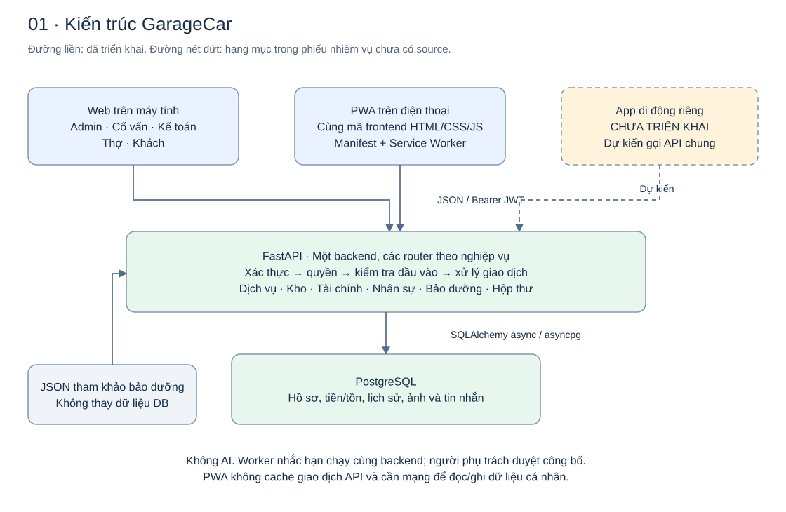
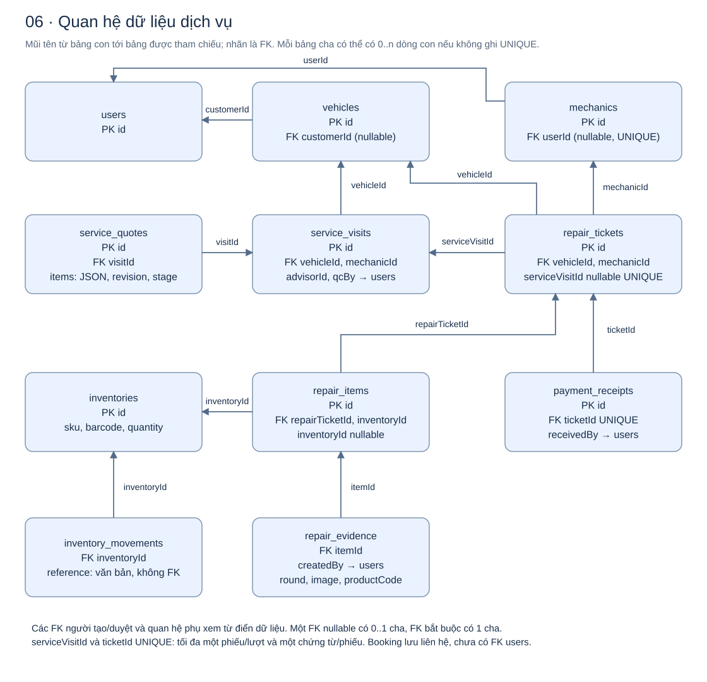
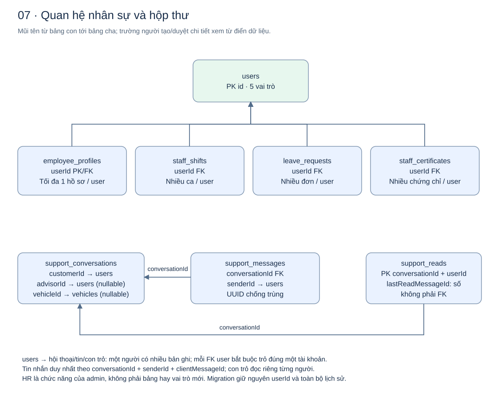
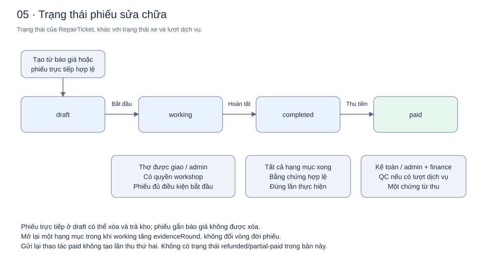
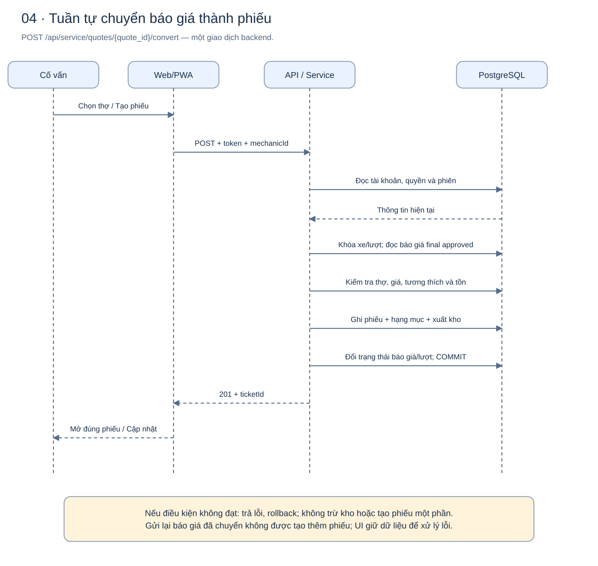
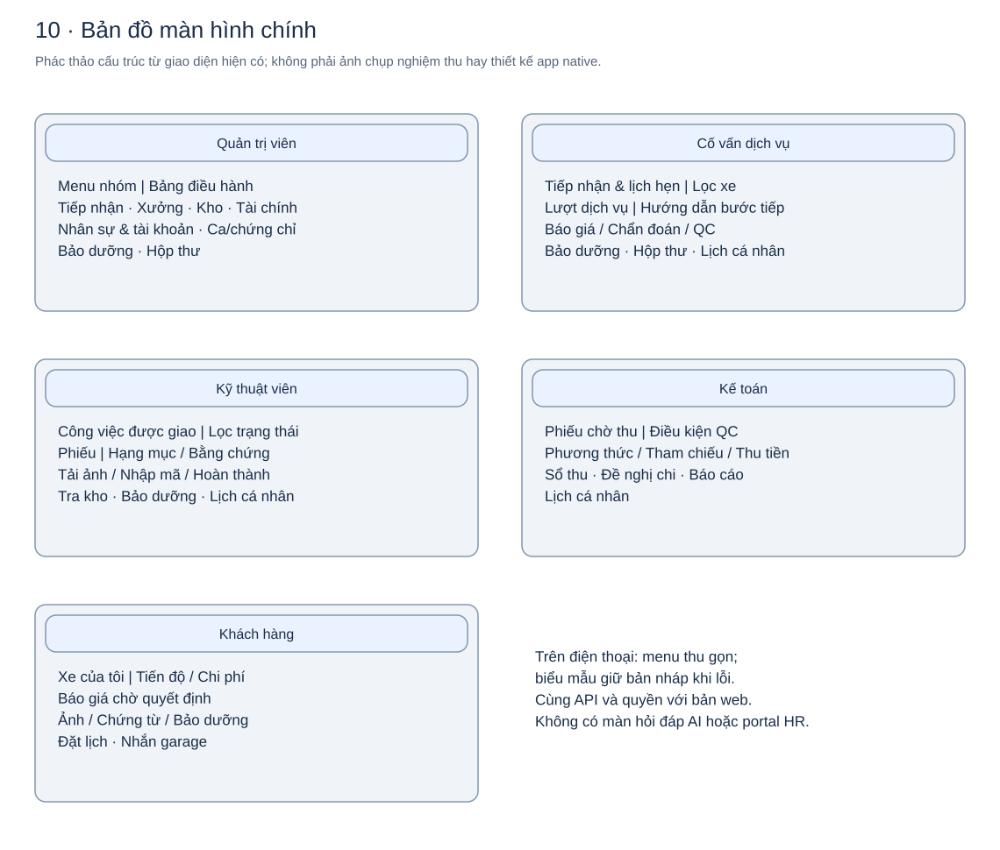
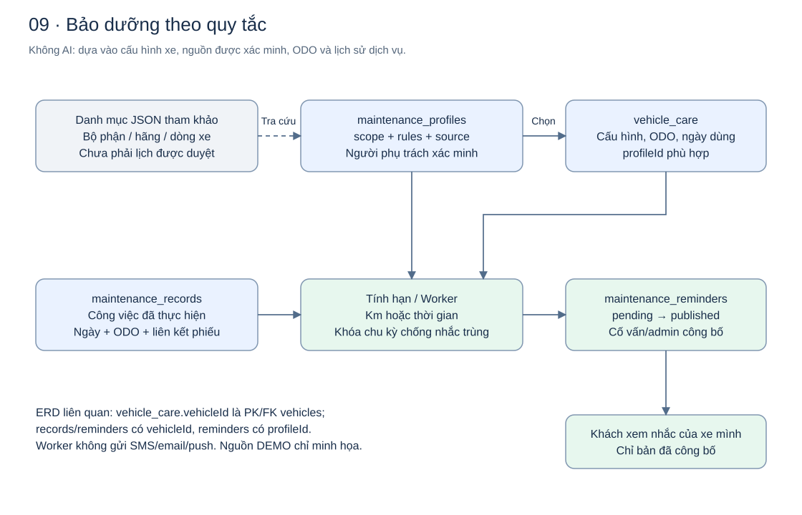
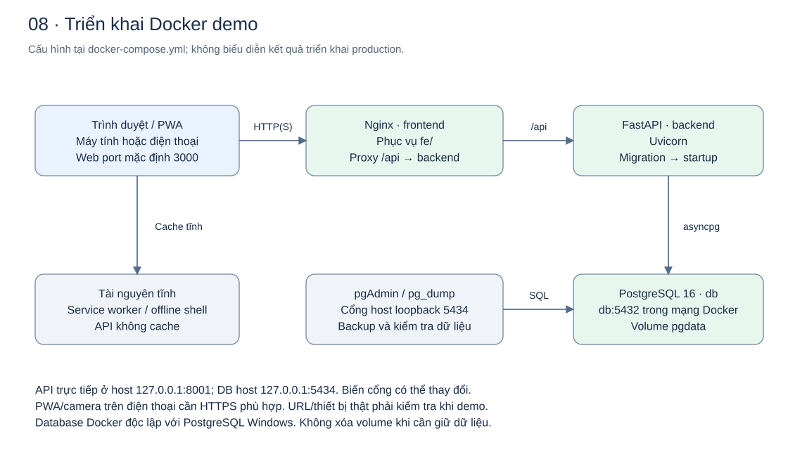

# Thiết kế hệ thống

## 1. Kiến trúc và công nghệ

| Thành phần       | Công nghệ hiện có             | Trách nhiệm                                              |
| ---------------- | ----------------------------- | -------------------------------------------------------- |
| Giao diện        | HTML/CSS/JavaScript, Chart.js | Portal theo vai trò, bảng, biểu mẫu, dashboard           |
| Backend          | Python, FastAPI, Pydantic     | API, xác thực, kiểm tra dữ liệu và nghiệp vụ             |
| Truy cập dữ liệu | SQLAlchemy async, asyncpg     | Session/giao dịch và PostgreSQL                          |
| Database         | PostgreSQL; Alembic           | Lưu dữ liệu có quan hệ, ràng buộc và nâng cấp            |
| Xác thực         | JWT, Argon2                   | Token và mật khẩu băm; tương thích hash cũ khi đăng nhập |
| Di động hiện có  | PWA, manifest, service worker | Cài qua trình duyệt; cache tài nguyên tĩnh               |
| Triển khai demo  | Docker Compose, Nginx         | Web/API cùng origin và DB riêng trong container          |

Không cần liệt kê mọi thư viện phụ trong phần giới thiệu công nghệ. Danh sách phiên bản cài đặt nằm ở `be/requirements.txt` và `package-lock.json`. App di động riêng là phần còn thiếu; sơ đồ dùng nét đứt để phân biệt với các thành phần đang chạy.

Backend là một ứng dụng có các module, chưa tách microservice. Router kiểm tra quyền/đầu vào và điều phối; các service chứa nghiệp vụ dùng lại. Một số xử lý vẫn nằm trong router. Không mô tả kiến trúc như đã áp dụng đầy đủ mọi tầng repository/domain nếu code chưa làm như vậy.

## 2. Thiết kế dữ liệu

| Nhóm         | Bảng                                                                           | Mục đích                                                     |
| ------------ | ------------------------------------------------------------------------------ | ------------------------------------------------------------ |
| Tài khoản    | users, login_attempts                                                          | Danh tính, vai trò, khóa chức năng/phiên, chống dò đăng nhập |
| Tiếp nhận    | vehicles, bookings, service_visits, service_quotes                             | Xe, lịch yêu cầu, từng lượt, báo giá có phiên bản            |
| Xưởng        | mechanics, repair_tickets, repair_items, repair_evidence                       | Phân công, thực hiện, chi phí và bằng chứng                  |
| Kho/danh mục | inventories, inventory_movements, brands, wages, system_parameters             | Vật tư, biến động, hãng, giá công, tham số                   |
| Tài chính    | payment_receipts, expenses                                                     | Thu và đề nghị/duyệt/chi                                     |
| Nhân sự      | employee_profiles, staff_shifts, staff_certificates, leave_requests            | Hồ sơ, lịch, năng lực và nghỉ                                |
| Bảo dưỡng    | maintenance_profiles, vehicle_care, maintenance_records, maintenance_reminders | Nguồn lịch, cấu hình xe, lịch sử, nhắc                       |
| Chăm sóc     | service_followups, support_conversations, support_messages, support_reads      | Sau bàn giao và hộp thư                                      |

Có 29 bảng ORM. `alembic_version` và bảng audit chuyển HR là bảng kỹ thuật ngoài danh sách ORM. [Từ điển dữ liệu](data-dictionary.md) được xuất trực tiếp từ metadata, bao gồm từng cột, kiểu, NULL, khóa và ràng buộc.

Các quan hệ cần giải thích khi bảo vệ:

- `vehicles.customerId` có thể NULL với dữ liệu chưa liên kết. Một khách có nhiều xe; không suy liên kết từ tên/điện thoại.
- `mechanics.userId` nullable và unique: hồ sơ thợ có thể chưa có tài khoản, nhưng một tài khoản không gắn hai hồ sơ thợ.
- Một xe có nhiều lượt; một lượt có nhiều phiên bản báo giá. Hạng mục báo giá nằm trong JSON, không có bảng `quote_items` riêng.
- `repair_tickets.serviceVisitId` nullable/unique: một lượt tối đa một phiếu; phiếu trực tiếp hoặc dữ liệu cũ có thể không có lượt.
- `repair_items.inventoryId` nullable: công việc chỉ có tiền công không cần vật tư. `inventory_movements.reference` là văn bản như `repair:123`, không phải FK.
- `payment_receipts.ticketId` unique; mỗi phiếu sửa tối đa một chứng từ thu. `repair_evidence` gắn hạng mục và lần thực hiện, ảnh nằm trong DB.
- `support_reads.lastReadMessageId` là số được API kiểm tra, không có FK trên cột này. Không vẽ thành FK trong ERD.
- `bookings` chưa có `customerId` FK; chỉ lưu thông tin đặt lịch/liên hệ.

## 3. Trạng thái và giao dịch

| Đối tượng      | Trạng thái/quy tắc chính                                                                         |
| -------------- | ------------------------------------------------------------------------------------------------ |
| Xe             | waiting, repairing, completed, delivered; trạng thái được đồng bộ với phiếu và thao tác bàn giao |
| Phiếu sửa      | draft → working → completed → paid                                                               |
| Báo giá        | pending, approved, rejected, superseded, converted; kèm stage preliminary/final và revision      |
| Đề nghị chi    | submitted → approved → paid; submitted có thể cancelled                                          |
| Nhắc bảo dưỡng | pending → published; chỉ công bố mới đến phía khách                                              |
| Hội thoại      | open/closed; người có quyền xử lý có thể mở lại                                                  |

Chuyển báo giá phải kiểm tra lại giá, tồn, tương thích và tài khoản thợ. Các thay đổi phiếu/hạng mục/kho/ledger/trạng thái cùng một giao dịch. Nếu bất kỳ điều kiện nào sai, toàn bộ thao tác không được lưu. Không dùng giá client gửi làm căn cứ thu.

Khóa dòng xe/lượt/phiếu và khóa vật tư theo thứ tự ID giữ trật tự khi hai request cùng thao tác. `commit` ở ranh giới hoàn tất của router; service không tự commit giữa luồng. Chứng từ thu và trạng thái paid được ghi cùng giao dịch; thao tác lặp không tạo chứng từ thứ hai.

## 4. Thiết kế quyền và phiên

Một request có ba câu hỏi riêng: **đã đăng nhập chưa; được phép làm chức năng này không; có quyền trên đúng bản ghi này không**. Sau đó mới xét trạng thái nghiệp vụ. Middleware đọc lại tài khoản/phiên hiện tại từ database nên token còn hạn vẫn bị chặn khi tài khoản đã khóa hoặc phiên bị thu hồi.

| Cơ chế                  | Điểm thực hiện                      | Ví dụ bị chặn                                          |
| ----------------------- | ----------------------------------- | ------------------------------------------------------ |
| JWT, active, version    | middleware/auth.py                  | Token cũ, tài khoản khóa, vai trò HR cũ                |
| Vai trò/quyền chức năng | core/permissions.py và dependencies | Thợ thu tiền; kế toán sửa kho; admin bị khóa hr        |
| Sở hữu/phân công        | Routers/service helpers             | Khách đọc xe người khác, thợ thao tác phiếu người khác |
| Quy tắc nghiệp vụ       | Router/service                      | Thu trước QC, thiếu ảnh, tự duyệt chi/nghỉ             |

Vai trò `admin` sau gộp có chức năng nhân sự. Tài khoản HR cũ không được tự nâng thành admin toàn quyền: migration giữ ID/lịch sử, lưu trạng thái cũ, khóa tài khoản và chức năng, thu hồi phiên. Quản trị hiện có xét quyền và mở lại theo [quy trình vận hành](../operations.md).

## 5. Thiết kế giao diện

| Màn hình     | Dữ liệu và thao tác chính                             | Kiểm soát trải nghiệm                                        |
| ------------ | ----------------------------------------------------- | ------------------------------------------------------------ |
| Tiếp nhận    | Tìm xe, chủ xe, lịch yêu cầu, mở lượt                 | Mở đúng lượt đang có, không tạo trùng khi state đổi          |
| Lượt dịch vụ | Tình trạng, báo giá, quyết định, phân thợ, QC         | Hiển thị bước tiếp theo, dùng lại hạng mục có kiểm tra giá   |
| Phiếu xưởng  | Hạng mục, ảnh, mã, thợ, trạng thái                    | Chặn thao tác không hợp lệ; giữ ảnh/lần thực hiện cũ         |
| Tài chính    | Phiếu chờ thu, phương thức, tham chiếu, receipt       | Phân biệt chưa thu và đã thu; không thay chứng từ cũ         |
| Nhân sự      | Hồ sơ mọi nhân viên, kỹ thuật viên, ca/nghỉ/chứng chỉ | Admin xử lý; khóa accounts không được làm hỏng hồ sơ nhân sự |
| Khách hàng   | Xe của mình, báo giá, tiến độ, ảnh, nhắc hạn, chat    | Không hiển thị dữ liệu khách khác; không có hỏi AI           |

Frontend không dùng framework SPA. Các module dùng chung tránh lặp lại toàn bộ giao diện giữa portal. Bảng có phân trang, workspace nhóm menu, biểu mẫu giữ nháp khi đồng bộ hoặc lỗi. Nội dung do người dùng nhập được escape trước hiển thị.

## 6. Bảo dưỡng và tác vụ nền

JSON `be/data/maintenance_catalog.json` cung cấp thư viện tra cứu. `docs/research/maintenance-reference.json` là tài liệu nghiên cứu, không phải bảng giao dịch. Lịch có quy tắc/phạm vi/nguồn xác minh được lưu trong DB. Worker quét theo lô, tạo nhắc pending theo khóa chu kỳ; cố vấn/admin công bố. Không dùng AI hoặc tự gửi thông báo qua dịch vụ bên thứ ba.

## 7. Triển khai và giới hạn

FastAPI có thể phục vụ frontend cùng origin khi chạy local. Cấu hình Compose thêm Nginx và PostgreSQL riêng. Startup kiểm tra schema; migration phải hoàn tất trước khi chạy. Compose demo tự gọi upgrade, còn DB đang sử dụng cần backup và kế hoạch nâng cấp.

PWA chỉ cache vỏ/tài nguyên tĩnh; API có dữ liệu cá nhân và request có Authorization không được cache. Không có queue giao dịch offline, push nền hoặc app native. Camera, cài PWA, in chứng từ và HTTPS trên điện thoại cần kiểm thử thực tế.

## 8. Quyết định thiết kế và đánh đổi

| Quyết định                          | Lý do                                   | Giới hạn cần biết                                                  |
| ----------------------------------- | --------------------------------------- | ------------------------------------------------------------------ |
| Backend chung cho portal/PWA        | Một nguồn dữ liệu và kiểm tra quyền     | App riêng còn phải xây client                                      |
| Ảnh trong PostgreSQL                | Cùng backup và quyền truy cập nghiệp vụ | Database/backup lớn dần; chưa dùng object storage                  |
| Polling                             | Đơn giản, phù hợp code hiện tại         | Không tức thời như WebSocket; tốn request khi nhiều người          |
| Giá tại thời điểm lập               | Giữ lịch sử tiền                        | Giá đổi cần kiểm tra/lập báo giá mới                               |
| JSON cho phạm vi/quy tắc/báo giá    | Linh hoạt dữ liệu có cấu trúc           | Cần validation ứng dụng; không phải mọi thuộc tính là bảng quan hệ |
| Khóa chức năng trên vai trò cố định | Dễ giải thích với 5 vai trò             | Chưa có tổ chức nhiều cấp/đa chi nhánh                             |

Các sơ đồ dữ liệu rút gọn để đọc được. Khi cần tra toàn bộ trường/FK, dùng từ điển tự xuất thay vì suy thêm các bảng chưa có.
