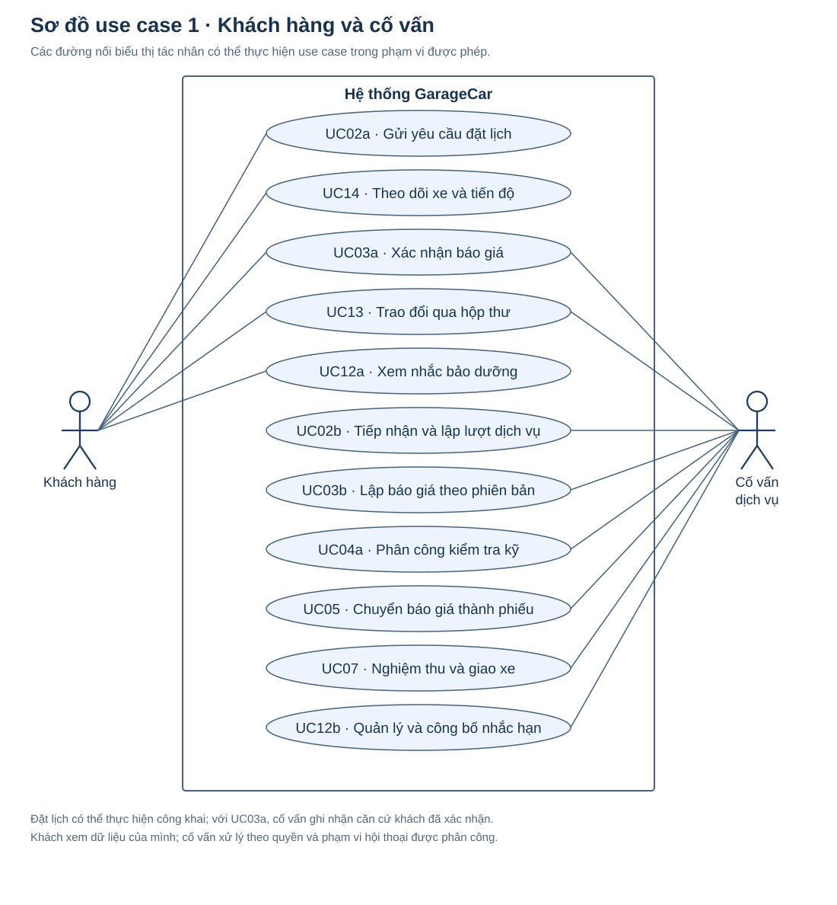
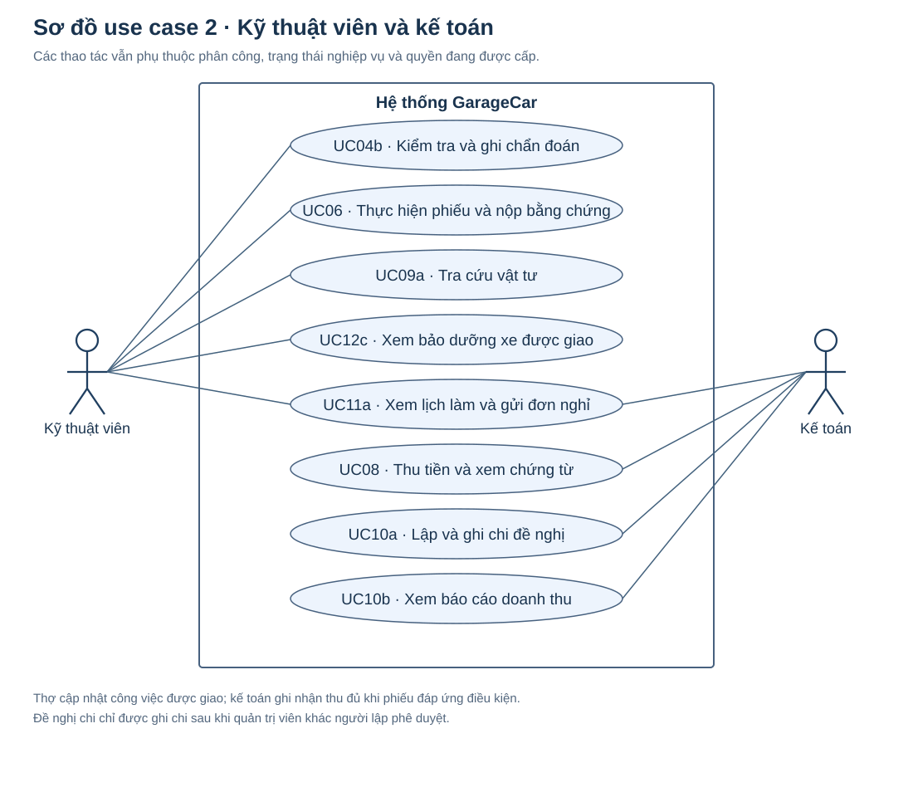
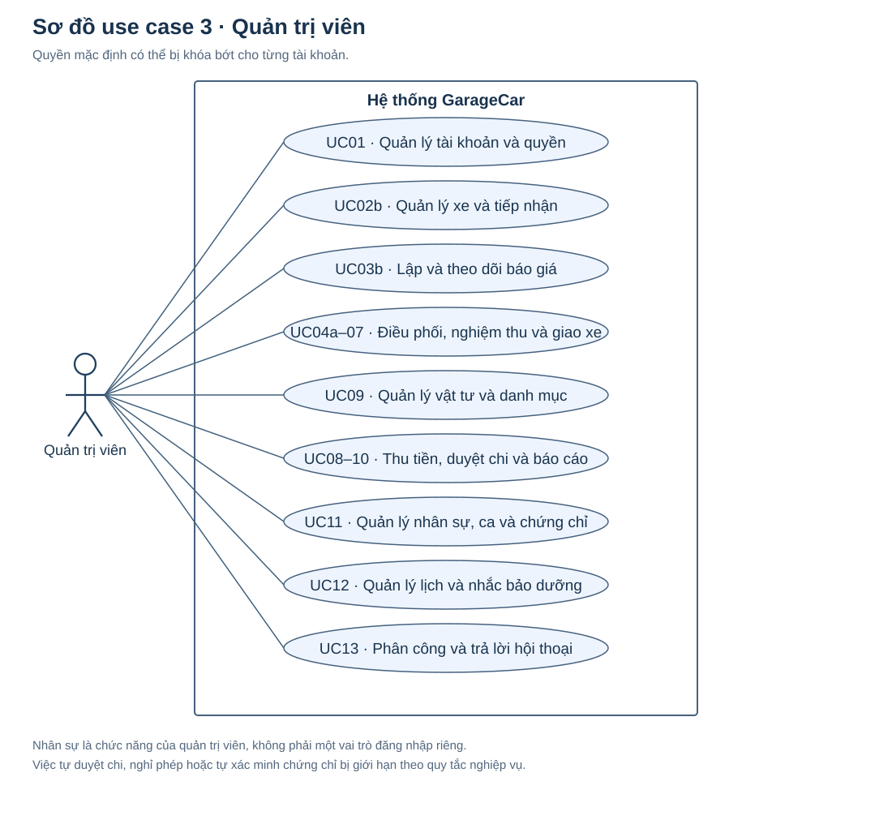

# Sơ đồ use case và bảng đối chiếu

Tài liệu này mô tả **hành vi đã có trong mã nguồn**, được đối chiếu ngày 04/11/2026. Hệ thống có năm vai trò đăng nhập: quản trị viên, cố vấn dịch vụ, kỹ thuật viên, kế toán và khách hàng. Người chưa đăng nhập vẫn có thể gửi yêu cầu đặt lịch; đây là khách truy cập công khai, không phải vai trò tài khoản thứ sáu.

Trong các hình, hình người là tác nhân, hình elip là chức năng, hình chữ nhật là ranh giới hệ thống; đường liền thể hiện tác nhân có thể tham gia chức năng. Quyền thực tế còn phụ thuộc tài khoản đang hoạt động, nhóm quyền bị khóa, quyền sở hữu hoặc phân công và trạng thái hồ sơ. Ký hiệu `a`, `b`, `c` chia nhỏ các nhóm UC01–UC14 trong [danh mục yêu cầu](requirements.md#7-danh-mục-use-case); chúng không phải mã API.

## 1. Khách hàng và cố vấn dịch vụ

## 2. Kỹ thuật viên và kế toán

## 3. Quản trị viên

## 4. Bảng đối chiếu chức năng và mã nguồn

| Mã trong hình | Chức năng                           | Tác nhân mặc định                                             | Điều kiện và giới hạn chính                                                              | Mã nguồn tham chiếu                                         |
| ------------- | ----------------------------------- | ------------------------------------------------------------- | ---------------------------------------------------------------------------------------- | ----------------------------------------------------------- |
| UC01          | Quản lý tài khoản và giới hạn quyền | Quản trị viên                                                 | `accounts`; chỉ năm vai trò; khóa chức năng không cấp thêm quyền                         | `be/routers/accounts.py`, `be/core/permissions.py`          |
| UC02a         | Gửi yêu cầu đặt lịch                | Khách hàng, khách truy cập                                    | Endpoint công khai; ngày hẹn không ở quá khứ; chưa liên kết FK tài khoản                 | `be/routers/bookings.py`                                    |
| UC02b         | Tiếp nhận và mở lượt                | Cố vấn, quản trị viên                                         | Cần quyền phù hợp; không bỏ qua kiểm tra trạng thái xe/lượt                              | `be/routers/vehicles.py`, `be/routers/service.py`           |
| UC03a         | Xác nhận báo giá                    | Khách hàng; cố vấn/quản trị viên ghi nhận thay                | Khách chỉ xác nhận xe mình; nhân viên phải ghi căn cứ liên hệ ít nhất 10 ký tự           | `be/routers/service.py`, hàm `decision`                     |
| UC03b         | Lập báo giá                         | Cố vấn, quản trị viên                                         | Phân biệt sơ bộ/chính thức; chính thức cần chẩn đoán; chưa xuất kho                      | `be/routers/service.py`, hàm `quote`                        |
| UC04a         | Phân công kiểm tra kỹ               | Cố vấn, quản trị viên                                         | Thợ đang hoạt động, có tài khoản; lượt chưa chuyển xưởng                                 | `be/routers/service.py`, hàm `assign_diagnosis`             |
| UC04b         | Ghi kết quả kiểm tra kỹ             | Kỹ thuật viên được phân công; cố vấn/quản trị viên theo quyền | Sơ bộ đã được chấp thuận; thay đổi chẩn đoán làm báo giá chính thức cũ hết hiệu lực      | `be/routers/service.py`, hàm `diagnosis`                    |
| UC05          | Chuyển báo giá thành phiếu sửa      | Cố vấn, quản trị viên                                         | Báo giá chính thức đã duyệt; kiểm tra thợ, giá, tương thích, tồn; cùng giao dịch         | `be/routers/service.py`, `be/services/repair_service.py`    |
| UC06          | Thực hiện phiếu và nộp bằng chứng   | Thợ được giao, quản trị viên theo quyền                       | Ảnh hoàn thành; vật tư cần ảnh bao bì và mã; cao áp cần chứng chỉ hợp lệ                 | `be/routers/repairs.py`, `be/routers/evidence.py`           |
| UC07          | Nghiệm thu và giao xe               | Cố vấn, quản trị viên                                         | Phiếu theo lượt hoàn thành và QC trước thu; giao xe theo điều kiện nghiệp vụ             | `be/routers/service.py`, `be/routers/vehicles.py`           |
| UC08          | Thu tiền, xem chứng từ              | Kế toán, quản trị viên                                        | Có `finance`; phiếu hoàn thành; lượt dịch vụ phải có QC; một chứng từ cho phiếu          | `be/routers/repairs.py`, `be/routers/finance_operations.py` |
| UC09/09a      | Quản lý hoặc tra cứu vật tư         | Quản trị viên quản lý; thợ tra cứu                            | Quyền xem không đồng nghĩa quyền sửa kho; xuất kho không làm tồn âm                      | `be/routers/inventory.py`, `be/services/repair_service.py`  |
| UC10a/10b     | Đề nghị chi, chi và báo cáo         | Kế toán, quản trị viên                                        | Quản trị duyệt chi; người lập không tự duyệt; chi sau khi duyệt                          | `be/routers/finance_operations.py`, `be/routers/reports.py` |
| UC11/11a      | Nhân sự, ca làm và nghỉ phép        | Quản trị viên quản lý; nhân viên xem/gửi việc cá nhân         | Không tự duyệt nghỉ hoặc tự xác minh chứng chỉ; kiểm tra ca trùng                        | `be/routers/hr_operations.py`, `be/routers/employees.py`    |
| UC12a         | Xem nhắc bảo dưỡng                  | Khách hàng                                                    | Chỉ nhắc đã công bố của xe thuộc tài khoản                                               | `be/routers/maintenance.py`, hàm `reminders`                |
| UC12b         | Lập lịch, quét và công bố nhắc      | Cố vấn, quản trị viên                                         | Cố vấn/admin có `maintenance`; xác minh lịch yêu cầu `catalog` (mặc định chỉ admin)      | `be/routers/maintenance.py`                                 |
| UC12c         | Xem bảo dưỡng xe được giao          | Kỹ thuật viên                                                 | Theo xe liên kết với phiếu của thợ; quyền `maintenance`                                  | `be/routers/maintenance.py`, `vehicle_access`               |
| UC13          | Trao đổi trong hộp thư              | Khách hàng, cố vấn, quản trị viên                             | Khách xem hội thoại mình; cố vấn xem chưa phân công hoặc mình phụ trách; admin phân công | `be/routers/messaging.py`                                   |
| UC14          | Xem xe, phiếu và tiến độ            | Khách hàng                                                    | Chỉ dữ liệu thuộc xe liên kết với khách                                                  | `be/routers/vehicles.py`, `be/routers/repairs.py`           |

Hình 13 dùng các nhóm `UC04a–07` và `UC08–10` để giữ sơ đồ gọn; bảng trên là căn cứ giải thích các thao tác cụ thể. Khách và nhân viên vẫn có thể xem/đổi thông tin tài khoản cá nhân theo giao diện và API tương ứng.

## 5. Kịch bản minh họa cho báo cáo

| Bước | Người thực hiện                                         | Kết quả                                  | Trường hợp bị chặn                                      |
| ---- | ------------------------------------------------------- | ---------------------------------------- | ------------------------------------------------------- |
| 1    | Khách gửi lịch; cố vấn tiếp nhận xe                     | Tạo yêu cầu/lượt dịch vụ                 | Ngày đặt lịch trong quá khứ                             |
| 2    | Cố vấn lập sơ bộ; khách hoặc cố vấn ghi nhận quyết định | Lưu quyết định trên phiên bản báo giá    | Báo giá không còn trạng thái chờ                        |
| 3    | Cố vấn phân thợ; thợ ghi chẩn đoán                      | Lượt có kết quả kiểm tra                 | Người không được phân công hoặc trạng thái chưa phù hợp |
| 4    | Cố vấn lập chính thức; khách duyệt                      | Báo giá chính thức đã được duyệt         | Chưa có chẩn đoán hoặc phiên bản cũ                     |
| 5    | Cố vấn tạo phiếu; thợ hoàn thành hạng mục               | Lưu phiếu, xuất kho và bằng chứng        | Không đủ tồn, sai giá, thiếu ảnh hoặc mã                |
| 6    | Cố vấn nghiệm thu; kế toán thu; cố vấn giao xe          | QC, một phiếu thu và trạng thái bàn giao | Chưa QC khi thu phiếu gắn lượt                          |

Đây là ví dụ luồng thông thường, không phải dữ liệu giao dịch thật. Phiếu trực tiếp không gắn lượt dịch vụ có quy tắc tương thích riêng; xem [nghiệp vụ và vai trò](../workflows.md).

## 6. Phạm vi và sản phẩm

Web/PWA và backend đã có trong repository. Ứng dụng di động riêng được nêu trong phiếu giao nhiệm vụ nhưng chưa có mã nguồn trong phiên bản hiện tại; cần tiếp tục triển khai hoặc thống nhất phạm vi với giảng viên. Hệ thống không tích hợp hỏi đáp AI. Các sơ đồ nói trên thể hiện use case của hệ thống hiện có, không khẳng định app riêng đã hoàn thành.
